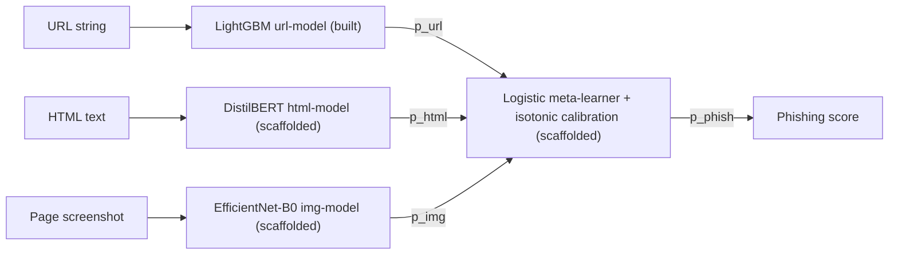

# PhishGuard

[](https://github.com/SolomonSmith-dev/phishguard/actions/workflows/ci.yml)  

A phishing URL classifier I had to break before I could trust it. The public dataset's labels were upside down and every legitimate URL in it started with `https://www.`. The model that ships is the one that still passes the leakage tests after those shortcuts were removed.

**Live: https://phishguard.soloserver.xyz** (demo at `/`, API at `POST /predict`, health at `/healthz`). It runs as a Docker container on a home server behind a Cloudflare tunnel, at no cost. `make smoke-live` checks it: 7/7 passed on 2026-11-17 for build `0685bf8`. That covers 75/75 scores within 1e-6 of the local model, 25/25 held-out phishing URLs flagged and 1 of the Tranco top 50 flagged. Deploy, rollback and privacy notes: [docs/deploy.md](./docs/deploy.md).

## The leakage finding

PhiUSIIL (Kaggle, ~235k URLs) gives a URL-only LightGBM model AUC above 0.99 on its own holdout. Three things made that number worthless, all caught by hand-crafted smoke tests rather than by reading the holdout:

1. **Label polarity is inverted.** Raw `label=1` means legitimate. Obvious phishing URLs were scoring 0.0. Fixed in `src/phishguard/data/load.py::_normalize_phiusiil_label`, locked by `tests/test_label_polarity.py`.
2. **100% of legitimate URLs are `https://www.*` and 0% carry a path.** The model was learning "has www, no path" instead of phishing. Fixed by canonicalizing (strip `www.`, normalize trailing slash) at both train and serve time, `tests/test_canonicalize.py`.
3. **`has_https` carried 47.6% of model gain** before the fixes and still 34.9% after the first two. v0.2 drops `has_https`, `has_http` and the length features. Top feature gain fell to 27.16% and `tests/test_no_leakage.py` enforces a 50% single-feature cap and an 80% top-3 cap.

Full write-up with before/after numbers: [LIMITATIONS.md](./LIMITATIONS.md).

## Evidence

| Claim | Value | Source file |
|---|---|---|
| Test AUC, v0.2 production model | 0.9943 raw booster; 0.9942 through the served path (ONNX session + isotonic calibrator) | `reports/url_baseline_v0_2.txt` (re-trained 2026-11-03 with `make train-url-v0_2`, byte-identical report); `reports/url_onnx_2026-11-03.md`; `reports/evaluation_v0_2.md` |
| Test AP / F1 / calibrated Brier | 0.9948 / 0.9782 / 0.0157 | `reports/url_baseline_v0_2.txt` |
| False-positive rate on Tranco top-5,000 (held out, never trained on), threshold 0.7 | 1.54% (2.52% at 0.5, 0.90% at 0.9), identical through the ONNX path | `reports/evaluation_v0_2.md`, `reports/url_onnx_2026-11-03.md`, `LIMITATIONS.md` |
| Top feature gain after ablation | `subdomain_depth` 27.16%, top-3 57.9% | `reports/url_baseline_v0_2.txt` |
| Tests | 64 test functions in `tests/` (74 cases with parametrization: 73 pass, 1 marked `known_fail` (xfail) on purpose for the leaky v0.1 model) | `grep -h "def test_" tests/*.py`; run with `make test` |
| ONNX serving | `POST /predict` runs the URL model through `onnxruntime.InferenceSession`; max abs diff vs the native booster 8.9e-8 over all 23,537 test URLs and 5,000 Tranco URLs, zero rows above 1e-5 (re-exported 2026-11-16 with the same numbers) | `src/phishguard/serving/url_onnx.py`, `reports/url_onnx_2026-11-03.md`, `reports/url_onnx_2026-11-16.md`, `tests/test_onnx_serving.py` |
| Live deploy | 7/7 smoke checks against https://phishguard.soloserver.xyz: build commit, health, demo page, 422 on bad input, parity 75/75 within 1e-6, phish 25/25 flagged at 0.5, Tranco top 50 1/50 flagged (`apple-dns.net`) | `scripts/smoke_live.py`, `scripts/smoke_fixtures.json`, `docs/deploy.md` |
| Leakage regression tests | `tests/test_no_leakage.py`, `tests/test_label_polarity.py`, `tests/test_canonicalize.py` | run on every commit by the `leakage-tests` pre-commit hook and in CI; model-dependent tests skip until `make train-url-v0_2` has produced artifacts |
| Pre-commit gate | ruff, ruff-format, mypy (strict), yaml/toml checks, `leakage-tests` (pytest on the three leakage test files, always runs) | `.pre-commit-config.yaml`; verified by planting an inverted label and disabled `www.` stripping: `pre-commit run --all-files` exits 1 with `3 failed, 10 passed, 2 skipped` |
| CI | GitHub Actions, Python 3.11: install, `pre-commit run leakage-tests`, full `pytest` | `.github/workflows/ci.yml` (added 2026-11-03; passing on `main`) |

Model card with calibration method, failure modes and versioning: [MODEL_CARD.md](./MODEL_CARD.md).

## How to run

```bash
make setup            # venv, deps, playwright chromium, pre-commit hooks
make data             # downloads PhiUSIIL and Tranco
make train-url-v0_2   # trains the production LightGBM ablation (24 s on an M4 MacBook Air, seed 42), then exports it to ONNX
make export-url-onnx  # re-export the booster to ONNX and write reports/url_onnx_<date>.md
make test             # pytest; leakage and label tests run once artifacts exist
make serve            # FastAPI on :8000, loads url_model_v0_2.onnx through ONNX Runtime
curl -s localhost:8000/predict -H 'content-type: application/json' \
  -d '{"url":"http://accounts-verify.secure-login.xyz/login.php"}'
make eval             # writes reports/evaluation_v0_{1,2}.md
make docker-up        # API + Postgres via docker compose
make docker-hf        # build and run the public image locally on :7860
make deploy-home      # build HEAD on the home server and swap the live container (docs/deploy.md)
make smoke-live       # 7 checks against https://phishguard.soloserver.xyz
```

## Built vs planned

**Built and runnable today**

- URL data pipeline: PhiUSIIL loader with label correction, Tranco probe set, URL canonicalization (`src/phishguard/data/`, `src/phishguard/features/`).
- 46 numeric URL features plus TLD as categorical; v0.2 serves 41 of them plus TLD (`src/phishguard/features/url_features.py`, `url_features_v0_2.json`).
- LightGBM URL classifier, 5-fold stratified CV, isotonic calibration. v0.1 (leaky, kept as a regression marker) and v0.2 (production).
- FastAPI service: `GET /healthz`, `POST /predict` taking URL plus optional HTML and screenshot. URL path runs the exported LightGBM graph in ONNX Runtime, then the isotonic calibrator in Python (`src/phishguard/serving/api.py`, `src/phishguard/serving/url_onnx.py`).
- ONNX export with verification: `src/phishguard/training/export_url_onnx.py` converts the booster with onnxmltools, restores the float64 split thresholds that the converter rounds to float32, and checks the graph against the native booster (`reports/url_onnx_2026-11-03.md`).
- GitHub Actions CI running the leakage hook and the full test suite (`.github/workflows/ci.yml`).
- Public deploy at https://phishguard.soloserver.xyz: hardened Docker image (`deploy/hf-space/`), home-server deploy script that waits for `/healthz` to report the commit (`scripts/deploy_home_server.py`), demo page at `/` (`src/phishguard/serving/static/demo.html`), live smoke test (`scripts/smoke_live.py`), 13 MB request body cap (`src/phishguard/serving/limits.py`).
- Prediction logging to Postgres with JSONL fallback and credential redaction on query strings; the public image stores only `scheme://host` (`src/phishguard/serving/prediction_log.py`, `tests/test_prediction_log.py`).
- Evidently drift report script (`src/phishguard/monitoring/drift.py`, `make drift`).
- Docker image and compose file with Postgres (`docker/`).
- Chrome extension stub (Manifest v3) that calls the local API and shows a badge (`extension/`).
- Playwright scrape pipeline and multimodal dataset builder, smoke-tested only (`src/phishguard/data/scrape.py`, `build_multimodal_dataset.py`).

**Scaffolded, not trained or measured**

- HTML model (DistilBERT fine-tune, `training/train_html.py`), screenshot model (EfficientNet-B0, `training/train_screenshot.py`) and the stacked logistic meta-learner (`training/train_fusion.py`). Training scripts and configs exist; no scraped corpus and no GPU run yet, so there are no checkpoints and no numbers.
- ONNX Runtime for the HTML and screenshot models. `api.py` opens their sessions when the files exist; those files have never been produced. Only the URL model runs through ONNX today.
- Late-fusion scoring. Without a fusion artifact the API averages whatever modality probabilities it has, URL only in practice.

**Planned, not started**

- Reliability diagrams, adversarial eval on the screenshot model, MLflow registry (dependency listed, not wired), Prometheus latency metrics.
- v0.3 data fixes listed in `LIMITATIONS.md`: add Common Crawl URLs so the legitimate class includes path-bearing URLs, or move to a character-level model that cannot be handed a featurizer shortcut.

Original 4-phase plan: [ROADMAP.md](./ROADMAP.md).

## Architecture (target)



Late fusion over early fusion because the modalities have very different cost. URLs are free. HTML needs a fetch. Screenshots need a headless render. Fusing late lets the service answer on the URL alone when the slow modalities time out, which is what it does today.

## Stack

| Layer | Used today | Scaffolded or listed only |
|---|---|---|
| Modeling | LightGBM, scikit-learn (isotonic calibration) | PyTorch, HuggingFace Transformers, torchvision |
| Tracking | Weights and Biases (optional, `WANDB_MODE=disabled` in the v0.2 target) | MLflow |
| Serving | FastAPI, Uvicorn, Pydantic, ONNX Runtime (URL model), onnxmltools (export) | ONNX Runtime for HTML and screenshot models |
| Data | pandas, tldextract, Playwright (smoke-tested) | PhishTank feed, CIRCL screenshots |
| Quality | pytest, hypothesis, ruff, mypy strict, pre-commit (incl. leakage tests), GitHub Actions | |
| Ops | Docker, docker compose, Postgres, Evidently, Cloudflare Tunnel (public deploy) | Prometheus |

## Repo layout

```
phishguard/
├── configs/                  # YAML per model (url_model_v0_2.yaml is production)
├── deploy/hf-space/          # public image: Dockerfile, pinned serve deps
├── docker/                   # Dockerfile, compose with Postgres
├── docs/deploy.md            # live deploy, rollback, privacy and limits
├── extension/                # Chrome MV3 stub
├── reports/                  # training and eval reports cited above
├── scripts/                  # deploy and live smoke test
├── src/phishguard/
│   ├── data/                 # load (label fix), scrape, multimodal builder
│   ├── features/             # URL canonicalization and feature extraction
│   ├── models/               # fusion and screenshot model definitions
│   ├── training/             # train_url, train_html, train_screenshot, train_fusion, evaluate
│   ├── serving/              # FastAPI app, demo page, body-size limit, prediction log
│   └── monitoring/           # Evidently drift report
├── tests/
├── LIMITATIONS.md            # the leakage write-up
├── MODEL_CARD.md
├── ROADMAP.md
└── Makefile
```

## Datasets

1. PhiUSIIL phishing URL dataset (Kaggle, ~235k URLs, balanced). Used for train/val/test.
2. Tranco top 1M. Top 5,000 used as a benign-only held-out probe.
3. PhishTank feed, CIRCL screenshots, self-scraped snapshots: planned inputs for the HTML and screenshot models.

## License

MIT.
