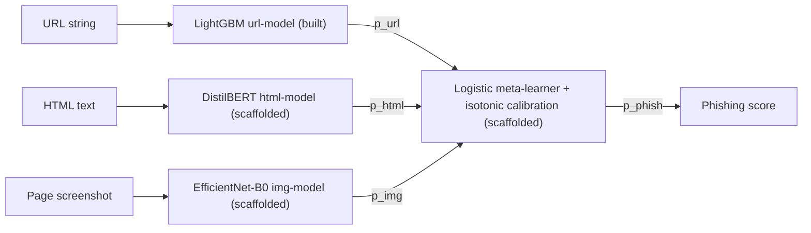

# PhishGuard

 

A phishing URL classifier I had to break before I could trust it. The public dataset's labels were upside down and every legitimate URL in it started with `https://www.`. The model that ships is the one that still passes the leakage tests after those shortcuts were removed.

## The leakage finding

PhiUSIIL (Kaggle, ~235k URLs) gives a URL-only LightGBM model AUC above 0.99 on its own holdout. Three things made that number worthless, all caught by hand-crafted smoke tests rather than by reading the holdout:

1. **Label polarity is inverted.** Raw `label=1` means legitimate. Obvious phishing URLs were scoring 0.0. Fixed in `src/phishguard/data/load.py::_normalize_phiusiil_label`, locked by `tests/test_label_polarity.py`.
2. **100% of legitimate URLs are `https://www.*` and 0% carry a path.** The model was learning "has www, no path" instead of phishing. Fixed by canonicalizing (strip `www.`, normalize trailing slash) at both train and serve time, `tests/test_canonicalize.py`.
3. **`has_https` carried 47.6% of model gain** even after the first two fixes. v0.2 drops `has_https`, `has_http` and the length features. Top feature gain fell to 27.16% and `tests/test_no_leakage.py` enforces a 50% single-feature cap and an 80% top-3 cap.

Full write-up with before/after numbers: [LIMITATIONS.md](./LIMITATIONS.md).

## Evidence

| Claim | Value | Source file |
|---|---|---|
| Test AUC, v0.2 production model | 0.9943 | `reports/url_baseline_v0_2.txt` (the `make eval` re-run in `reports/evaluation_v0_2.md` rounds to 0.9942) |
| Test AP / F1 / calibrated Brier | 0.9948 / 0.9782 / 0.0157 | `reports/url_baseline_v0_2.txt` |
| False-positive rate on Tranco top-5,000 (held out, never trained on), threshold 0.7 | 1.54% (2.52% at 0.5, 0.90% at 0.9) | `reports/evaluation_v0_2.md`, `LIMITATIONS.md` |
| Top feature gain after ablation | `subdomain_depth` 27.16%, top-3 57.9% | `reports/url_baseline_v0_2.txt` |
| Tests | 35 test functions in `tests/`, 1 marked `known_fail` (xfail) on purpose for the leaky v0.1 model | `grep -c "^def test_" tests/*.py`; run with `make test` |
| Leakage regression tests | `tests/test_no_leakage.py`, `tests/test_label_polarity.py` | run under `pytest`; model-dependent tests skip until `make train-url-v0_2` has produced artifacts |
| Pre-commit gate | ruff, ruff-format, mypy (strict), yaml/toml checks | `.pre-commit-config.yaml` |
| CI | none yet | no `.github/workflows` |

Model card with calibration method, failure modes and versioning: [MODEL_CARD.md](./MODEL_CARD.md).

## How to run

```bash
make setup            # venv, deps, playwright chromium, pre-commit hooks
make data             # downloads PhiUSIIL and Tranco
make train-url-v0_2   # trains the production LightGBM ablation (under 10 min on an M-series Mac, seed 42)
make test             # pytest; leakage and label tests run once artifacts exist
make serve            # FastAPI on :8000, auto-loads v0.2 when present
curl -s localhost:8000/predict -H 'content-type: application/json' \
  -d '{"url":"http://accounts-verify.secure-login.xyz/login.php"}'
make eval             # writes reports/evaluation_v0_{1,2}.md
make docker-up        # API + Postgres via docker compose
```

## Built vs planned

**Built and runnable today**

- URL data pipeline: PhiUSIIL loader with label correction, Tranco probe set, URL canonicalization (`src/phishguard/data/`, `src/phishguard/features/`).
- 47 numeric URL features plus TLD as categorical (`src/phishguard/features/url_features.py`).
- LightGBM URL classifier, 5-fold stratified CV, isotonic calibration. v0.1 (leaky, kept as a regression marker) and v0.2 (production).
- FastAPI service: `GET /healthz`, `POST /predict` taking URL plus optional HTML and screenshot. URL path runs the native LightGBM booster and calibrator (`src/phishguard/serving/api.py`).
- Prediction logging to Postgres with JSONL fallback and credential redaction on query strings (`src/phishguard/serving/prediction_log.py`, `tests/test_prediction_log.py`).
- Evidently drift report script (`src/phishguard/monitoring/drift.py`, `make drift`).
- Docker image and compose file with Postgres (`docker/`).
- Chrome extension stub (Manifest v3) that calls the local API and shows a badge (`extension/`).
- Playwright scrape pipeline and multimodal dataset builder, smoke-tested only (`src/phishguard/data/scrape.py`, `build_multimodal_dataset.py`).

**Scaffolded, not trained or measured**

- HTML model (DistilBERT fine-tune, `training/train_html.py`), screenshot model (EfficientNet-B0, `training/train_screenshot.py`) and the stacked logistic meta-learner (`training/train_fusion.py`). Training scripts and configs exist; no scraped corpus and no GPU run yet, so there are no checkpoints and no numbers.
- ONNX Runtime serving. `api.py` opens ONNX sessions for the HTML and screenshot models when their files exist. Those files have never been produced, so no ONNX inference has run.
- Late-fusion scoring. Without a fusion artifact the API averages whatever modality probabilities it has, URL only in practice.

**Planned, not started**

- GitHub Actions CI, public deploy (Fly.io or Cloud Run), reliability diagrams, adversarial eval on the screenshot model, MLflow registry (dependency listed, not wired), Prometheus latency metrics.
- v0.3 data fixes listed in `LIMITATIONS.md`: add Common Crawl URLs so the legitimate class includes path-bearing URLs, or move to a character-level model that cannot be handed a featurizer shortcut.

Original 4-phase plan: [ROADMAP.md](./ROADMAP.md).

## Architecture (target)



Late fusion over early fusion because the modalities have very different cost. URLs are free. HTML needs a fetch. Screenshots need a headless render. Fusing late lets the service answer on the URL alone when the slow modalities time out, which is what it does today.

## Stack

| Layer | Used today | Scaffolded or listed only |
|---|---|---|
| Modeling | LightGBM, scikit-learn (isotonic calibration) | PyTorch, HuggingFace Transformers, torchvision |
| Tracking | Weights and Biases (optional, `WANDB_MODE=disabled` in the v0.2 target) | MLflow |
| Serving | FastAPI, Uvicorn, Pydantic | ONNX Runtime |
| Data | pandas, tldextract, Playwright (smoke-tested) | PhishTank feed, CIRCL screenshots |
| Quality | pytest, hypothesis, ruff, mypy strict, pre-commit | GitHub Actions |
| Ops | Docker, docker compose, Postgres, Evidently | Prometheus, Fly.io / Cloud Run |

## Repo layout

```
phishguard/
├── configs/                  # YAML per model (url_model_v0_2.yaml is production)
├── docker/                   # Dockerfile, compose with Postgres
├── extension/                # Chrome MV3 stub
├── reports/                  # training and eval reports cited above
├── src/phishguard/
│   ├── data/                 # load (label fix), scrape, multimodal builder
│   ├── features/             # URL canonicalization and feature extraction
│   ├── models/               # fusion and screenshot model definitions
│   ├── training/             # train_url, train_html, train_screenshot, train_fusion, evaluate
│   ├── serving/              # FastAPI app, prediction log
│   └── monitoring/           # Evidently drift report
├── tests/
├── LIMITATIONS.md            # the leakage write-up
├── MODEL_CARD.md
├── ROADMAP.md
└── Makefile
```

## Datasets

1. PhiUSIIL phishing URL dataset (Kaggle, ~235k URLs, balanced). Used for train/val/test.
2. Tranco top 1M. Top 5,000 used as a benign-only held-out probe.
3. PhishTank feed, CIRCL screenshots, self-scraped snapshots: planned inputs for the HTML and screenshot models.

## License

MIT.
